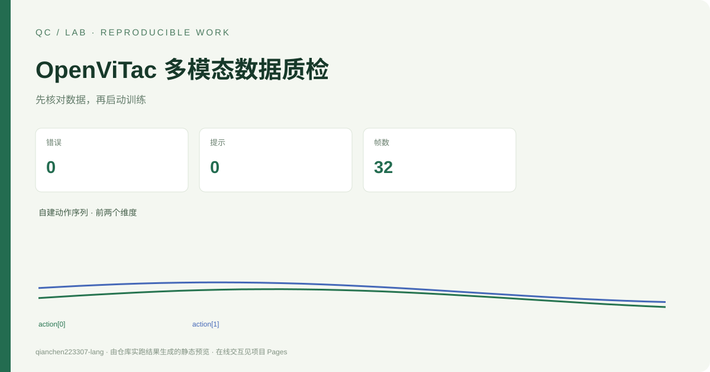
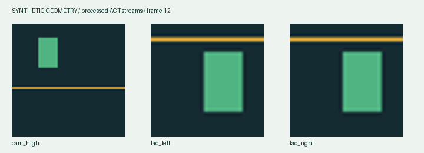
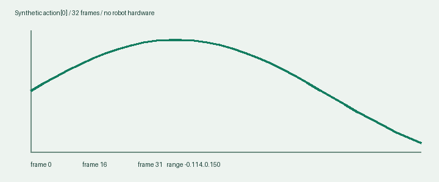

# OpenViTac 多模态数据质检



[在线交互演示](https://qianchen223307-lang.github.io/openvitac-data-audit/) · [实验与样例结果](results/) · [验证流程](.github/workflows/ci.yml)


[在线演示](https://qianchen223307-lang.github.io/openvitac-data-audit/) · [English](README.en.md) · [数据接口来源](SOURCES.md)

这是独立编写的 CPU 工具，检查 **OpenViTac ACT 处理后的 HDF5 episode**。检查字段、帧数、数值和图像是否满足明确契约，在启动训练前给出可定位、可修复的诊断。新增内容是检查器、CLI、报告、合成 fixtures、测试和演示；没有复制上游实现。

演示全部是自建几何数据，包含一个正常 episode、一个故意损坏 episode，以及一个用于格式识别的最小 raw 布局。这里的检查结果不代表机器人性能、实机经验或论文复现。





## 运行

Python 3.10+，普通 CPU 即可。仓库根目录运行：

```bash
python -m pip install -e .
python -m openvitac_data_audit demo
python -m unittest discover -s tests -v
python -m openvitac_data_audit check fixtures/valid --output results/check-valid
```

检查用户文件及选择图像流：

```bash
python -m openvitac_data_audit check /path/to/episodes --images cam_high,tac_left,tac_right --output results/my-audit
python -m openvitac_data_audit check /path/to/episode_0.hdf5 --images cam_high,cam_wrist --output results/vision
```

Windows 同样支持普通本地绝对路径。输入目录扫描顶层 `.hdf5` / `.h5`，不递归修改数据。输入文件以只读方式打开。`--images` 中的名称为必需项，未选择的图像不读取、不强制存在。状态和动作始终必需。

## 支持的唯一格式：openvitac-act-v1

| HDF5 路径 | 约束 |
| --- | --- |
| `/action` | `[T,8]`，有限数值 |
| `/observations/qpos` | `[T,8]`，有限数值 |
| `/observations/images/{name}` | `[T,H,W,3]`，`uint8`，已解码图像 |

`T>=1`，选中流的 T 必须相同；不同流的 H/W 可以不同。默认图像为 `cam_high,tac_left,tac_right`；`cam_wrist` 仅被选中时必需。不同 episode 可以长度不同。训练端会缩放图像，源文件无需预先变成 256×256。`source_phase` 属性不作为读取前提。

原始 OpenViTac 的 `embodiment/joint` 与 JPEG 字节图像不属于本工具的输入：检测到典型 raw 布局会给出先运行上游转换器的提示，不自动转换。不支持任意 HDF5、LeRobot、模型权重或仿真。

## 检查和报告

- `ACT_REQUIRED/ACT_FORMAT/ACT_OPEN`：格式、可读容器及必需 dataset。
- `ACT_LENGTH/ACT_SHAPE/ACT_DTYPE`：非空且一致的帧数，固定向量维数，HWC uint8 图像。
- `ACT_FINITE/ACT_READ`：按 32 帧块实际读取全部选中字段，定位 NaN/Inf 和读失败。
- `ACT_REPEAT`：连续完全相同图像达到 10 帧时提示复查，可用 `--repeat-threshold` 调整；静止场景和无接触触觉可合法重复，所以只有 warning。

输出 `report.json` 和自包含 `report.html`。每条诊断均有 `check_id,severity,path,message,hint`。退出码：`0` 无 error（可含 warning），`1` 数据检查失败，`2` CLI 参数/不存在输入。`demo` 退出 0 表示样例生成与运行完成，故意损坏样例的 error 在报告内保留。

`results/summary.json` 为实际运行摘要，`results/{valid,invalid,raw}/` 为实际报告。演示预期：正常 0 error / 0 warning；故意损坏 4 error / 1 warning；raw 1 error。动作报告最多保留前 256 帧曲线，检查仍覆盖全部选中数据。

本次 Python 3.12.14 实跑：12 项测试通过；正常/异常文件的实际模块 CLI 退出码分别为 0/1。记录见 `results/verification.json` 和 `results/test-results.xml`。

## 能力与局限

这是数据工程、接口检查和自动化验证的作品。帧数对应不等于传感器同步检测；无时间戳时不估计延迟。重复帧仅表示待复查。工具不执行模型、机器人控制、任务成功评估或能耗测量，不宣称能耗/成功率提升。AI 辅助范围见 [AI_USE.md](AI_USE.md)。本工具与 OpenViTac 官方团队无隶属或背书关系。

## 固定环境与验证

使用 Python 3.12。锁文件包含开发、构建及跨平台运行依赖，首次安装后即可复跑：

```bash
python -m venv .venv
# Windows: .venv\Scripts\activate
# macOS / Linux: source .venv/bin/activate
python -m pip install -r requirements.lock
python -m pip install --no-build-isolation --no-deps -e .
python -m pytest -q
python -m openvitac_data_audit demo
```

Pages 目录为 `docs/`，包含可直接打开的独立 HTML。交互展示读取已计算结果；完整计算在本地 Python 运行。构建时的来源、数据类型和实验局限见本文及来源文档。

更新演示数据后，执行 `python scripts/build_site.py` 重建独立网页。静态结果预览对应本仓库已记录的完整实验；重新计时会因机器与系统负载不同而变化。
